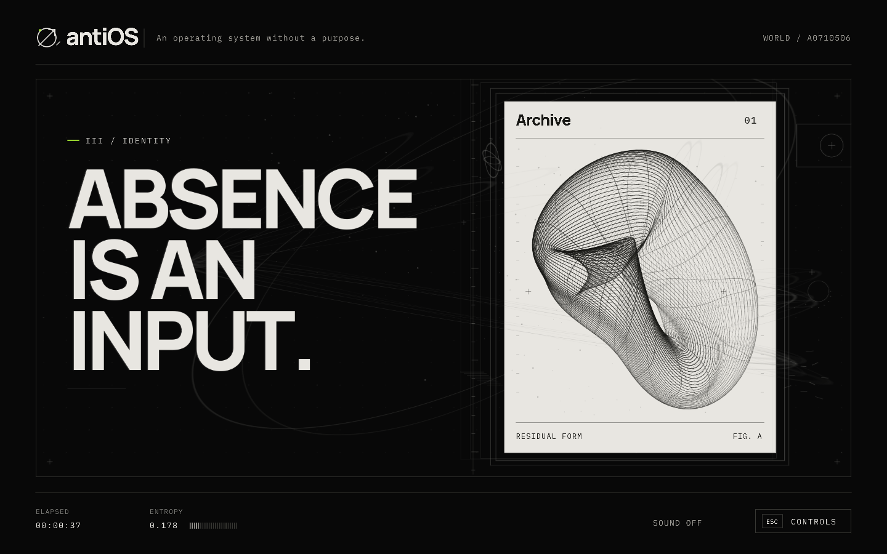
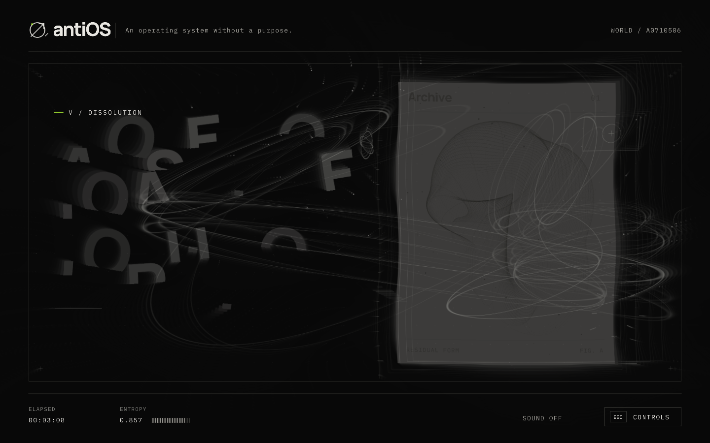

# antiOS

*An operating system without a purpose.*

antiOS is a place where software abandons utility and becomes an object of contemplation.

It does not organize your life.

It exists.



*Plate 01. Identity. World A0710506, 37 seconds.*

## Exhibition notes

The surface is shared by seven organisms. Observer follows a disturbance. Archive carries impressions of its previous positions into its geometry. Void draws particles toward an opening and erases them. Echo revisits a gesture after its source has moved on. Fragment breaks and slowly recovers. Monument carries the language of the world and waits for a disturbance. Unknown winds through the field on its own trajectory.

Move through the field to leave a trace. A slow movement lets curious organisms approach. A fast one disperses particles, and a held click reverses the field. When the cursor falls still, the artwork gives more space to its own motion. Figures draw close enough to share a boundary. Old gestures return after a delay. Silence occupies Genesis and returns in stretches of stillness.

The first cycle passes through Genesis, Formation, Identity, Distortion, Dissolution, and Rebirth over about four minutes. The curves overlap, and gestures alter the clock. As the structure loosens, old compositions appear and the phrases become glyphs again. Another cycle starts from the surviving world.



*Plate 02. Dissolution. World A0710506, 188 seconds.*

## Enter the artwork

Unpack the release for your platform. Run `./antios` on Linux or open `antios.exe` on Windows. The executable contains the shaders and fonts and runs offline. Linux needs a running X11 or Wayland session, ALSA, and a graphics driver. The GitHub Linux release is built and tested on Ubuntu 22.04. Local builds use the system glibc of their build machine. Windows builds target 64-bit Windows 10 or newer and use WASAPI for audio.

| Input | Action |
| --- | --- |
| Escape | Reveal or dismiss the controls. In fullscreen, return to the window. |
| F11 | Toggle fullscreen. |
| Space | Pause or resume. |
| M | Enable sound or mute it. Each launch starts muted. |
| − / + | Adjust volume. Click the volume line with the controls open. |
| D | Toggle reduced motion. |
| G | Cycle Auto, Low, Medium, and High quality. |
| S / Shift+S | Save the current artwork as PNG, or make a 3840 × 2400 print. |
| R | Confirm a new world. |
| Q | Confirm and exit. |
| Enter / Escape | Confirm or cancel a pending new world or exit. |

Reduced motion is available from the controls. It reduces organism displacement, feedback, and the intensity of pointer effects. Low quality lowers the internal render resolution, reduces the engraving density, and caps the window at 30 FPS. The overlay and exports keep the requested output dimensions.

## Installation and prints

```sh
# Open a 12-minute autonomous installation with the cursor hidden.
antios --exhibition --duration 720

# Print the opening world at 37 seconds without the surrounding controls.
antios --render field.png --at-frame 2220 --size 3840x2400 --clean

# Produce eight seconds of 24 FPS footage as numbered PNGs and an H.264 MP4.
antios --frames course --at-frame 888 --count 192 --fps 24 --size 1920x1200 --clean --mp4 course.mp4
```

Add `--show-cursor` for installations where the pointer should remain visible. An installation with no duration keeps evolving until it is closed. The Escape key exposes the controls even while the installation runs autonomously. Use `--seed <decimal>` to choose a world and `--backend vulkan`, `--backend dx12` or `--backend gl` to choose a graphics API. Output frame numbers are zero based. The frame directory must be new or empty. Video encoding uses an FFmpeg installation on `PATH` with `libx264`; the MP4 is silent.

Exports run at a fixed simulation step and ignore local memory. Keep the seed, frame numbers, frame rate, resolution, rendering quality, and graphics backend the same to reproduce a sequence. Pixel output can vary between drivers. Output sizes above the graphics adapter's texture limit return an error.

## Build and verification

Use stable Rust 1.86 or newer. On Debian and Ubuntu, install `build-essential pkg-config libasound2-dev libxkbcommon0 libxkbcommon-x11-0 libwayland-client0 libvulkan1 libegl1` and an appropriate driver. Mesa's `mesa-vulkan-drivers` includes a software adapter for headless Linux exports. On Windows, install Rust's MSVC toolchain and the Visual Studio Build Tools C++ workload with the Windows SDK.

```sh
cargo fmt --all -- --check
cargo clippy --locked --all-targets -- -D warnings
cargo test --locked
cargo build --locked --release
```

The release binary is `target/release/antios` or `target/release/antios.exe`. Distribute it with the MIT license, `THIRD_PARTY_NOTICES.txt`, the Rust standard-library notice, and the two bundled typeface notices from `assets/`. This repository’s GitHub Actions workflow runs the Windows checks and builds its standalone release package. On Linux, `tests/linux-window.sh` drives the real window using an isolated X11 display, a window manager, `xdotool`, and Python. It covers fullscreen and Escape, preferences, paused capture, high-resolution printing, reset, confirmation, persistent memory, and timed installation exit.

The development build was tested on Linux and cross-compiled for Windows x86-64. The Linux checks exercised a native X11 window, Mesa Vulkan and OpenGL rendering, PNG and MP4 export, and a virtual ALSA output. Native Windows, WASAPI, Wayland window presentation, and physical graphics or sound devices remain unverified in this build environment.

## Materials

The drawing is assembled from GPU instances and custom WGSL distance fields. The Archive plate is an analytic, deformed 3D surface engraved by intersecting paths. The paths follow the paper organism's position history, the cursor's force, and the entropy curve. Two offscreen images exchange the previous frame's residue. The final pass adds the sharp control labels. Manrope ExtraBold and IBM Plex Mono are embedded under the SIL Open Font License. The application positions, tracks, and masks each glyph directly.

A single 60 Hz simulation drives all seven organisms, the particle field, and all six temporal states. A small SplitMix64 generator makes the worlds repeatable. wgpu first tries the native graphics APIs for the platform and then OpenGL or OpenGL ES through a compatible driver. Auto quality starts conservatively on integrated and software devices and can step down during a slow session. A system without a compatible adapter receives a diagnostic and exits.

The sound is synthesized on demand. Three coupled oscillators, filtered grains and sparse pitched signals respond to entropy, proximity, speed, collapse and inactivity.

The local journal contains seeds, simulation time, entropy, surviving organisms, compositional impressions, and significant in-app gestures. It keeps twelve sessions. During recall, the older impressions scatter and lose their precision. The application writes through a temporary file and keeps concurrent sessions under an exclusive journal lock. Nothing leaves the computer. On Linux the files live under `${XDG_DATA_HOME:-$HOME/.local/share}/antios`. On Windows they live under `%LOCALAPPDATA%\antiOS\antiOS\data`. Use `--data-dir <path>` to choose a directory. Screen captures are saved in its `captures` folder. The app reads the previous session on opening and checkpoints about every 18 seconds and before closing.

## License

MIT. Bundled typography keeps its original SIL Open Font License. The antiOS mark is in `assets/antios-mark.svg`.
